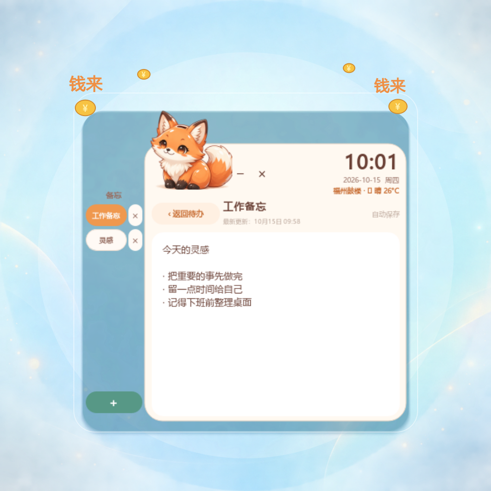

# 狐狸待办小组件

一个面向 Windows 的本地桌面悬浮待办小组件。它使用 PyQt5 实现无边框透明窗口、置顶、拖动、边缘收起、待办、习惯打卡和可切换的备忘标签；狐狸会做轻微上下漂浮和眨眼，金币会落入储钱罐，“钱来”文字会轻轻浮动。

## 效果预览

<p align="center">
  
</p>

## 功能

- 无边框、透明外部窗口、置顶、可拖动和自由调整大小。
- 拖到屏幕边缘自动收起，点击狐狸恢复面板。
- 待办新增、编辑、完成/撤销和删除；已完成事项单独查看。
- 打卡习惯管理，可按周一到周日分别勾选。
- 左侧备忘标签栏：新建、切换、双击改名、删除和多行编辑。
- 每条备忘显示最新更新时间，并自动保存到本地。
- 右键小狐狸可切换自动轮播、固定表情，或选择自己的本地图片；自定义图片会保存到本机，并自动提取主色调整主题。
- 点击备忘页右上角的「工作日志」，一键生成当天的 Markdown 工作日志文档。
- 右上角显示 24 小时制时间、日期星期，以及所选城市的中文天气和图标；首次启动可手动输入城市或按公网 IP 自动识别，点击天气栏可随时修改。
- 单实例保护，重复启动时唤起已有窗口。
- 不依赖系统原生按钮样式，使用狐狸主题配色。

## 环境要求

- Windows 10/11
- Python 3.10 或更高版本
- PyQt5 5.15+

## 快速开始

1. 克隆仓库并进入项目目录。
2. 双击 `安装依赖.bat`。它会创建项目自己的 `.venv` 并安装 `requirements.txt`。
3. 双击 `启动狐狸待办.bat`。
4. 如需桌面快捷方式，在项目目录中右键使用 PowerShell 运行 `make_desktop_shortcut.ps1`。

也可以使用命令行安装：

```powershell
py -3 -m venv .venv
.venv\Scripts\python.exe -m pip install -r requirements.txt
.venv\Scripts\pythonw.exe main.py
```

## 分享给别人使用

如果对方电脑没有 Python，可以在开发电脑上双击 `build_release.bat`。脚本会使用 PyInstaller 生成无需安装 Python 的 Windows 发布目录：

1. 将生成的 `release` 文件夹整体压缩成 ZIP。
2. 把 ZIP 分享给对方并解压。
3. 对方双击其中的 `install.bat`，程序会安装到当前用户的 `%LOCALAPPDATA%\FoxTodoWidget`，并自动创建桌面快捷方式。

首次启动时会弹出地点设置窗口，可以输入城市名，也可以点击“自动识别”。之后点击右上角天气文字即可再次切换城市。

## 工作日志

在左侧备忘栏点击 `＋` 新建备忘，点击标签切换内容。编辑会自动保存；点击备忘页右上角的「工作日志」后，会生成类似下面的文件：

```text
exports/工作日志-20261015.md
```

文档会包含当天日期、生成时间、全部备忘标签、正文和每条记录的最新更新时间。同一天再次生成会更新当天的日志文件。

## 数据与隐私

- 待办、打卡、备忘和地点设置只保存在本机的 `data/state.json`；发布版位于 `%LOCALAPPDATA%\FoxTodoWidget\data\state.json`。
- 工作日志只保存在本机的 `exports/` 文件夹。
- `data/state.json`、`exports/` 和 `.venv/` 已加入 `.gitignore`，不会被提交到 GitHub。
- 城市名称通过 Open-Meteo 地理编码查询，天气通过 Open-Meteo 获取；自动识别使用公网 IP 城市服务，不需要账号或 API 密钥；断网时显示 `—`。
- 项目不会上传你的待办、打卡或备忘内容。

## 项目结构

```text
main.py                    主程序
requirements.txt           Python 依赖
requirements-build.txt     发布版打包依赖
assets/                    狐狸 PNG 素材
docs/preview.png           GitHub README 效果预览图
data/                      本地运行数据（不提交）
exports/                   工作日志输出目录（不提交）
安装依赖.bat               创建虚拟环境并安装依赖
启动狐狸待办.bat           静默启动
build_release.bat           生成无需 Python 的 Windows 发布版
安装发布版.bat              安装发布版并创建桌面快捷方式
install.bat                 发布包中的英文兼容安装入口
launch_hidden.vbs           使用 pythonw.exe 启动，避免控制台窗口
make_desktop_shortcut.ps1  生成 Windows 桌面快捷方式
```

## 开发检查

```powershell
.venv\Scripts\python.exe -m py_compile main.py
```

运行时如需修改天气地点，可在 `main.py` 中调整 `FIXED_WEATHER_LOCATION`、`WEATHER_LATITUDE` 和 `WEATHER_LONGITUDE`。

## 许可证

本项目使用 [MIT License](LICENSE)。
